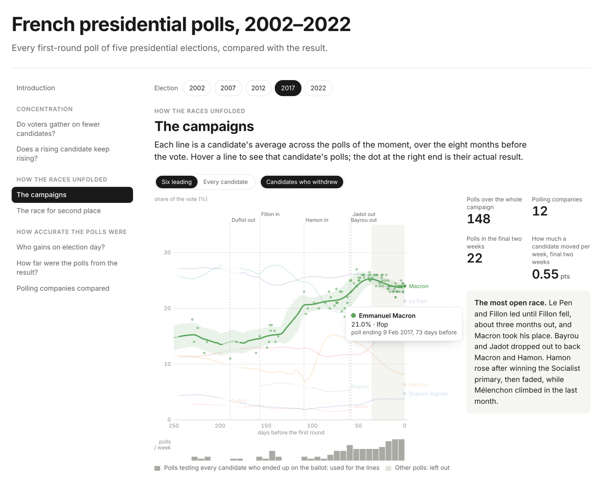

<h1 align="center">French presidential polls, 2002–2022</h1>

<p align="center">
How the first-round polls of five French presidential elections compare with the vote, and what they say about
strategic voting.
</p>

<p align="center">
  <a href="https://clarasalas.github.io/strategic-voting-polls-2RS/">
    
  </a>
</p>

<p align="center">
  <a href="https://clarasalas.github.io/strategic-voting-polls-2RS/">
    
  </a>
</p>

<p align="center">
Click the image to explore every campaign poll by poll: hover a line to see a candidate's polls, and compare the
polls with the result.
</p>

## About

In a two-round election, only the top two candidates of the first round reach the runoff. Voters whose favourite
looks out of reach may switch to a candidate who can make it: this is strategic voting. This project is one of three
that study how it works, with an agent-based model,
[strategic-voting-abm-2RS](https://github.com/clarasalas/strategic-voting-abm-2RS), and a geographic study,
[strategic-voting-geo-2RS](https://github.com/clarasalas/strategic-voting-geo-2RS). Polls are voters' main source of
information about who can make it, so this one studies the polls themselves, in three parts:

1. **Concentration.** Does the vote gather on fewer candidates, and when: over the campaign, or at the very end?
2. **How the races unfolded.** Each campaign poll by poll, and how early the polls showed who would reach the runoff.
3. **How accurate the polls were.** How far the final polls were from the result, who gained on election day, and how
   the polling companies compare.

Concentration is measured with the Herfindahl–Hirschman index (HHI), the sum of the squared vote shares: the higher
it is, the more the vote is gathered on a few candidates. All results are descriptive: when the result differs from
the polls, either the polls were off or voters changed their minds late, and these data cannot tell which.

## Main findings

**Voters gather on fewer candidates at the very end, not during the campaign.** Over the months before the vote, the
polls mostly spread out across more candidates; when they did concentrate, it was because candidates dropped out.
Between the final polls and election day, the vote gathered on fewer candidates in every election, clearly so in 2007
and 2022.

<details>
<summary>Supporting evidence: telling voters apart from candidates dropping out</summary>

<br>

Concentration rises either because voters move to the bigger candidates or because candidates drop out. To separate
the two, the HHI is also computed on a fixed group, the candidates who won at least 2% of the vote: changes there
are voters moving, the rest is candidates dropping out. Change in HHI:

| | 2002 | 2007 | 2012 | 2017 | 2022 |
|---|---|---|---|---|---|
| During the campaign: voters moving | −0.032 | −0.041 | −0.020 | −0.009 | +0.006 |
| During the campaign: candidates dropping out | +0.004 | −0.002 | +0.042 | +0.006 | +0.020 |
| From the final polls to the vote: voters moving | +0.002 | +0.011 | +0.007 | +0.001 | +0.020 |

Table: `results/tables/concentration_decomposition.csv`.

</details>

**The polls come close, but they miss together.** In the final two weeks, a single poll typically missed a
candidate's result by about one to two and a half points, closest in 2017 and furthest in 2022. Averaging all the
polls barely helps, so the gap is not noise in individual polls: either they all leaned the same way, or voters moved
after the last polls. One pattern repeats in all five elections: the candidate in third place in the final polls did
at least as well on election day, as late strategic voting would produce. Polling companies differ little from each
other.

<details>
<summary>Supporting evidence: accuracy by election, the third place, the companies</summary>

<br>

* **Typical miss per candidate**, polls of the last two weeks (root mean square error over the candidates on the
  ballot), with the same measure for the average of those polls in brackets: 1.6 (1.5) in 2002, 1.6 (1.4) in 2007,
  1.5 (1.3) in 2012, 0.9 (0.8) in 2017, 2.4 (2.3) in 2022 points. Polls of one election miss together, so these are
  five cases, not a trend.
* **Third place**: on average 2.6 points better than polled (Le Pen in 2002, Mélenchon in 2022), and the fourth 2.1
  points worse in four elections of five. Poll bias would produce the same pattern.
* **Companies**, each one's last poll before each election: the eight with a final poll in at least three elections
  are within about 0.3 points of that year's average. Harris Interactive and Ipsos come out slightly closer to the
  result, Kantar and CSA slightly further, which could be chance.

Tables: `error_by_poll.csv`, `error_by_role.csv`, `error_final_poll_by_pollster.csv`.

</details>

More in the [interactive page](https://clarasalas.github.io/strategic-voting-polls-2RS/): each campaign poll by poll,
the race for the runoff, momentum and the polling companies. The study itself is in notebooks 05 to 07, every
decision behind it in [`docs/study_plan.md`](docs/study_plan.md), and every number in a table in
[`results/tables/`](results/README.md).

## Reproduce

```bash
pip install -r requirements.txt
for nb in notebooks/0*.ipynb; do jupyter nbconvert --to notebook --execute --inplace "$nb"; done
PYTHONPATH=src python -m polls.page          # rebuilds the interactive page, docs/index.html
python -m pytest tests
```

The notebooks run in order, 01 to 07, each reading what the previous ones wrote (see
[`notebooks/`](notebooks/README.md)). Every source is pinned and the downloads are committed in `data/raw/`, so the
whole pipeline runs offline and gives the same tables; notebook 01 goes online only for a pin left blank in
`config/sources.yaml`. The hand-filled files, `config/*.csv` and the worklists in `validation/`, are never
overwritten by a rerun. The results were produced with Python 3.13. The interactive page is a single standalone
file, published with GitHub Pages from the `docs/` folder (see [`docs/README.md`](docs/README.md)).

<details>
<summary><strong>Repository layout</strong></summary>

<br>

```
config/          pinned sources, election dates, and the hand-editable name and party mappings
data/
  raw/           downloads exactly as received, never edited
  interim/       parsed tables, one per source, thinning and cross-check
  final/         the final dataset: polls, scenarios, corrections
  abm_input/     poll input for the model's empirical mode (prepared, not used)
validation/      worklists filled in by hand against the original documents
notebooks/       the pipeline (01–04) and the study (05–07)
src/polls/       the code the notebooks call: parsers, mappings, thinning, metrics, poll average
results/
  tables/        every table the study produces
  figures/       static versions of its figures
tests/           tests of the metrics and the time axis
docs/            the interactive page (generated), the study plan and its decisions
```

Each folder has its own README.

</details>

<details>
<summary><strong>Pipeline</strong></summary>

<br>

| Notebook | Reads | Writes |
|---|---|---|
| `01_collect_and_parse` | the sources (`config/sources.yaml`) | `data/raw/`, `data/interim/polls_*.csv`, `results.csv`, `parse_errors.csv` |
| `02_thin_rolling` | interim polls, `validation/flagged_clients.csv` | `data/interim/thinning.csv` |
| `03_cross_check` | interim polls, thinning | `data/interim/crosscheck_*.csv`, the worklists in `validation/` (once) |
| `04_final_dataset` | interim tables, filled worklists | `data/final/` |
| `05_polls_descriptive` | `data/final/polls.csv` | `results/tables/coverage_*`, `trajectories_*`, `ranks_*`, `pollsters_*`, `noise_*`, figures |
| `06_polls_vs_results` | final polls, results | `results/tables/structure_*`, `error_*`, `cliff_*`, `momentum_*`, `stylized_facts.csv`, figures |
| `07_parameters` | final polls, results | `results/tables/parameters_*`, `data/abm_input/`, figures |
| `python -m polls.page` | final polls, results, the tables of 05 and 06 | `docs/index.html` |

</details>

<details>
<summary><strong>The data and its sources</strong></summary>

<br>

The polls come from the French Wikipedia lists of polls, at fixed revisions, with france-politique.fr for 2002 and
NSPPolls for 2022 as second sources. Rolling polls are thinned so that each interview counts once. Where two sources
cover the same poll they are compared share by share, and every disagreement was settled by hand against the
pollster's report or the Commission des sondages notice; a random sample of 30 polls per election was checked the
same way. The result, `data/final/polls.csv`, holds 693 polls and 1,149 scenarios, with 136 corrections applied
(see [`data/`](data/README.md) and [`validation/`](validation/README.md)).

* **Polls, 2002–2022**: the French Wikipedia lists of polls, at fixed revisions for
  [2002](https://fr.wikipedia.org/w/index.php?oldid=236399441),
  [2007](https://fr.wikipedia.org/w/index.php?oldid=233109259),
  [2012](https://fr.wikipedia.org/w/index.php?oldid=238741176),
  [2017](https://fr.wikipedia.org/w/index.php?oldid=239719711) and
  [2022](https://fr.wikipedia.org/w/index.php?oldid=239942428).
* **Polls, 2002**: [france-politique.fr](https://www.france-politique.fr/sondages-electoraux-presidentielle-2002.htm),
  live copy and Wayback capture of 1 October 2026. It gives the client of each poll.
* **Polls, 2022**: [NSPPolls](https://github.com/nsppolls/nsppolls), `presidentielle.json` at commit `ddcd5ce`. It
  gives the client, the rolling flag and the Commission des sondages notice.
* **Official first-round results**: `data/FR-electoral_data.csv` in
  [strategic-voting-abm-2RS](https://github.com/clarasalas/strategic-voting-abm-2RS), at commit `8e99f86`.
* **Original documents** for the validation: pollsters' reports and Commission des sondages notices, linked row by
  row in the worklists.

Pins are in `config/sources.yaml`; every download is logged with its SHA-256 in `data/raw/manifest.csv`.

</details>

<details>
<summary><strong>Methodological choices</strong></summary>

<br>

* **Wikipedia is the base for every election**, so one source covers all five. For 2002 and 2022 the cross-check
  corrections are applied to it; polls only the second source has are not added.
* **Thinning.** Releases of a rolling poll share interviews. Within one pollster's series for one client, a release
  is dropped when its fieldwork overlaps a kept one, so each interview counts once (Erikson and Wlezien). OpinionWay's
  CNews and *Les Echos* series of 2022 are treated as one series sharing daily online samples, an assumption the
  notices support without stating it.
* **Party** is the label at the time of the poll (Juppé is UMP in 2014, LR from 2015). Orientation codes (DVG, DVD,
  EXD) are not parties and read as unaffiliated (SE).
* **Slot.** A tested candidate fills the place of a final candidacy when it is the same person, or the same party at
  the time, allowing for renamings (UMP → LR, FN → RN…); never across parties, even when a party later backed the
  candidate.
* **Ballot scenario.** Per poll, the hypothesis that fills the slot of every candidacy with at least 2% of the vote.
  It may also test candidates who will not run (Taubira in 2022): that is the poll voters saw.
* **Time** is counted in days before the first round, from the end of fieldwork (2007 and 2012: publication date).
* **Poll average**: a Gaussian kernel with a 10-day bandwidth, at least 3 polls nearby. Figures widen the window where
  polls are sparse and draw those stretches pale.
* **Shares** are rescaled to 100; every metric is also kept on raw shares. A share given as below a threshold counts
  as half its bound.
* **HHI rather than CENP** to compare elections, since CENP depends on the number of candidates.

Every decision, with its reason, is in [`docs/study_plan.md`](docs/study_plan.md).

</details>

<details>
<summary><strong>Limits</strong></summary>

<br>

* 2007 and 2012 dates are publication dates, usually 1 to 5 days after fieldwork.
* Small candidates, mostly at 2% or less, are missing in many 2007 and 2012 polls, so their shares can sum below 100.
* Before a party chose its candidate, Wikipedia can file the share under the eventual candidate (Mamère for Voynet
  or Lipietz in 2002).
* Sample sizes are given only from 2017, and are the base of respondents giving a voting intention.
* No undecided rate: polls leave out those who give no intention, about a quarter of respondents. No runoff polls.
* Five elections: every pattern above rests on five cases.

</details>

---

Clara Salas (ENS-PSL). Complementary analysis to the agent-based model
[strategic-voting-abm-2RS](https://github.com/clarasalas/strategic-voting-abm-2RS).
